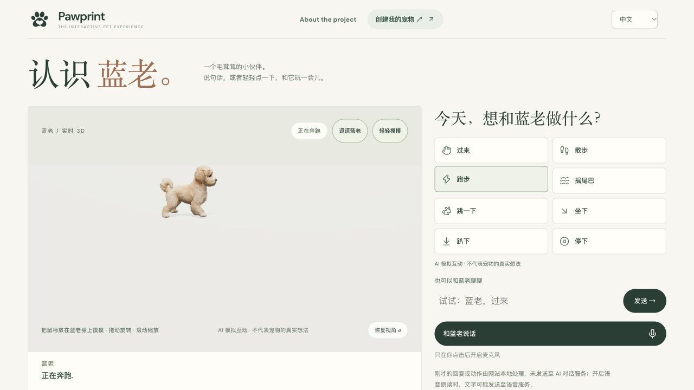

# 蓝老：疾跑、换步态、连续转弯复查

2026-11-09。本轮修改已构建到本机网站：<http://127.0.0.1:8788/app.html?lang=zh>。

## 本轮结果

- 走路、小跑和疾跑使用同一个连续的落脚控制器。实际移动速度决定步态；加减速时逐步调整四条腿的节奏，不重启动作或突然换姿势。
- 疾跑有独立的落脚顺序、两段短暂腾空、躯干收伸、前后重心起伏和稳定头部。它不再只是加速播放原来的小跑动画。
- 普通跑动沿保持出发朝向的弧线转弯。支撑脚的位置固定在地面；摆动脚根据弯道预测下一次落点，内外侧脚走不同距离。
- 连续跑动会预先计划下一段路线，并在进入急弯之前减速。路段衔接保留速度和步态相位；窄窗口允许更紧的慢速弧线。
- 停止时先制动，再让仍在空中的脚依次落下、收回站姿。坐下、趴下、起身仍走原有的姿态过渡。
- 无人互动时仍保留原先的随机探索和 20–45 秒趴卧休息。

本轮没有重新生成模型，也没有更换网格、贴图或蒙皮文件。新增的是现有骨骼上的实时步态与路径控制。

## 研究依据及应用边界

[Walter & Carrier, 2007, Ground forces applied by galloping dogs](https://carrier.biology.utah.edu/Dave%27s%20PDF/Walter%20galloping%20ground%20forces.pdf)（J Exp Biol，DOI 10.1242/jeb.02645）研究了犬类疾跑时四肢的受力和触地顺序。实现采用四脚分别触地的旋转式疾跑：左后 → 右后 → 右前 → 左前，循环中包含收拢与伸展阶段的短暂腾空，并加入适度躯干屈伸。没有把四只脚做成同时起落的弹跳。

[Afelt 等，1983，Speed control in animal locomotion: transitions between symmetrical and nonsymmetrical gaits in the dog](https://ane.pl/index.php/ane/article/download/646/646/668)描述了犬类不同步态转换时步长、频率和肢体时序的变化。实现据此保留连续步伐，逐步改变各腿相位。

以上研究并非对蓝老本犬的动作捕捉。网页中的距离使用模型单位；速度、抬脚高度和身体幅度为适应现有模型而调校，不能当作实际米/秒或临床生物力学结论。

## 迭代中发现并修正的问题

1. 初版将身体和落脚统一到世界坐标，解决支撑脚随身体整体旋转的问题；随后调整了摆动脚的落点预测，避免加速时脚落在身体后面。
2. 真实骨骼测试暴露后腿离地偏晚、膝关节接近伸直时跳变。缩短过度拖后的支撑阶段，并根据加速度预测落脚时间。
3. 连续路线测试暴露接续急弯减速不足，以及窄窗口无法顺着当前朝向出发。加入下一段路线的曲率预判，扩大安全慢转弧线的选择范围。
4. 将真实模型接到最终路线后，再发现快速换速与弯道中的前腿伸直顿挫。调整疾跑和转弯时的胸部高度，为肩肘缓冲留出空间，再复测完整动作。

## 验证

`node --test`：**199 / 199 通过**，无失败、跳过或取消。

`node node_modules/vite/bin/vite.js build`：成功。直接构建前端，没有运行或覆盖真实 AI 评测。

新增及更新的回归测试：

- 真实 GLB 骨骼的对角小跑、四肢分别触地的旋转式疾跑，以及每周期两段腾空。
- 30、60、120 fps 下的走路 → 小跑 → 疾跑 → 小跑 → 走路和连续转向，检查着地脚漂移、穿地与关节跳变。
- 在四个不同疾跑时刻发出停止，检查最后落脚、恢复站姿，以及之后坐下、趴下、站起。
- 多个随机种子、宽窄视窗与旋转相机下的 480 段路线；检查出发朝向、转速、边界和到达。
- 三种帧率下的连续路线衔接；保留速度，不原地换方向。
- 将真实骨骼控制器接到宽窄视窗中的连续实际路线，检查组合运行时的落脚与关节连续性。

真实网页通过界面按钮检查：连续奔跑和转弯、散步 → 跑步 → 散步 → 停下、坐下 → 趴下 → 起身再跑 → 停下。检查期间浏览器警告和错误列表为空。见 `browser-events.json`。

## 网页实测画面

以下为实际浏览器截图，没有使用生成图片替代运行结果。

预览由约 16.3 秒连续截图按实测时间间隔编码，包含按钮点击；截图采样约 15 fps，不代表网页渲染帧率。原网页仍使用 requestAnimationFrame。

## 数值诊断及剩余边界

`node review/gallop-2026-11-09/measure.mjs` 可重做真实骨骼诊断，结果保存在 `metrics.json`。五组 120 Hz 样本中，持续支撑阶段的单帧脚部漂移均低于 0.000001 模型单位。独立采样的走路、小跑、疾跑、换速、转向均未发现有效穿地。

这些结果说明落脚和动作连续性得到改善，不等于皮肤或毛发已达到实拍质量。现有模型仍使用原来的腿部骨骼和蒙皮；诊断中部分三角形边长相对绑定姿态仍会明显变化（各组最大边长比约 3.4–3.9）。毛纹随这些局部形变变化的问题，后续仍需要更细的关节拓扑和权重处理。
